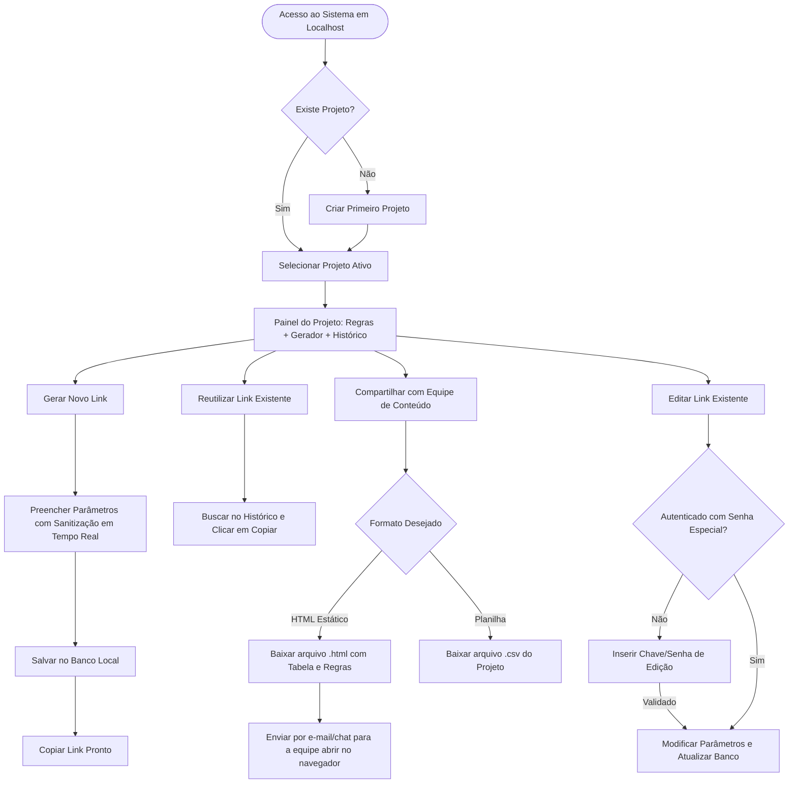

# PRD — Documento de Requisitos do Produto
## Gerador de Links UTM — Itaipu Parquetec

---

## 1. Visão Geral

- **Nome do Produto:** Gerador de Links UTM — Itaipu Parquetec
- **Elevator Pitch:** Para a equipe de Comunicação e Marketing do Itaipu Parquetec que precisa rastrear campanhas com consistência sem depender de planilhas frágeis e dispersas, o **Gerador de Links UTM** é uma plataforma interna centralizada que gera URLs rastreadas padronizadas, armazena o histórico agrupado por projetos e oferece um banco de links pesquisável e editável. Além disso, disponibiliza regras claras de taxonomia e permite gerar arquivos HTML estáticos autônomos e planilhas CSV para que a equipe de conteúdo copie os links oficiais com facilidade em qualquer computador.
- **Objetivo do MVP:** Entregar uma aplicação web funcional rodando 100% em ambiente local (`localhost`), que permita criar projetos, gerar links com parâmetros UTM padronizados (GA4), armazenar esses links em banco de dados local com histórico consultável, permitir edição restrita via autenticação/senha especial e exportar visões estáticas (HTML/CSV) para fácil compartilhamento com os times de criação e conteúdo.

---

## 2. Personas

### Persona 1: Analista de Tráfego e Mídia de Performance
- **Nome fictício:** Lucas Rocha (27 anos)
- **Perfil:** Analista de Marketing Digital e Mídia Paga no Itaipu Parquetec. Gerencia campanhas no Meta Ads, Google Ads, LinkedIn Ads e parcerias institucionais.
- **Dores principais:**
  - Precisa gerar dezenas de URLs por semana e a planilha do Google Sheets frequentemente sofre edições acidentais que quebram fórmulas.
  - Variações de digitação (ex: `cpc`, `CPC`, `facebook`, `fb`, espaços indesejados) poluem e fragmentam os relatórios do Google Analytics 4.
  - Perde tempo procurando links antigos usados em criativos anteriores para reaproveitá-los.
- **O que quer alcançar:** Gerar URLs em segundos com parâmetros higienizados automaticamente, salvá-las no projeto correspondente e ter a certeza de que a taxonomia do GA4 permanecerá intacta.
- **Como descobriria o produto:** Comunicado interno da equipe de marketing e fixação do endereço nos favoritos do navegador da equipe.

### Persona 2: Analista de Comunicação Institucional / Criador de Conteúdo
- **Nome fictício:** Mariana Souza (31 anos)
- **Perfil:** Responsável pelo conteúdo orgânico, assessoria, postagens em redes sociais, disparos de e-mail marketing e links da bio do Itaipu Parquetec.
- **Dores principais:**
  - Não domina as regras técnicas de parâmetros UTM e tem receio de montar links errados que quebrem a navegação ou o rastreio.
  - Precisa dos links corretos rapidamente para colar nos agendamentos de posts ou no material dos designers.
  - Dificuldade de saber quais são os padrões recomendados da instituição (ex: quando usar `stories`, `feed`, `reels` ou `newsletter`).
- **O que quer alcançar:** Uma interface visual com "colinha de regras" embutida, além de poder receber uma página HTML estática limpa com a lista oficial de links e botões de "Copiar", sem precisar mexer em banco de dados ou configurações técnicas.
- **Como descobriria o produto:** Recebimento do guia/link gerado pela área de mídia e treinamento interno.

---

## 3. User Stories Priorizadas (MoSCoW)

### Must Have (Essenciais para o MVP)
1. **US01:** *Como* colaborador de marketing, *eu quero* criar e selecionar projetos (ex: "Hackathon 2026", "Vestibular Parquetec") *para* agrupar e organizar os links conforme as iniciativas institucionais.
2. **US02:** *Como* colaborador de marketing, *eu quero* preencher os parâmetros (`url_destino`, `utm_source`, `utm_medium`, `utm_campaign`, `utm_term`, `utm_content`) *para* compor uma URL parametrizada no padrão GA4.
3. **US03:** *Como* colaborador de marketing, *eu quero* que o sistema higienize automaticamente os parâmetros (minúsculas, sem acentos, sem espaços) *para* garantir qualidade de dados nos relatórios.
4. **US04:** *Como* usuário, *eu quero* consultar um guia fixo de regras/convenções de taxonomia na própria tela *para* saber exatamente como preencher cada canal com consistência.
5. **US05:** *Como* usuário, *eu quero* visualizar e copiar a URL final gerada com 1 clique *para* utilizá-la com agilidade nas peças de divulgação.
6. **US06:** *Como* colaborador, *eu quero* consultar a lista histórica de links por projeto com busca rápida *para* localizar links criados anteriormente.
7. **US07:** *Como* gestor/administrador de campanha, *eu quero* acessar uma área de edição protegida por chave/senha especial *para* alterar ou corrigir links sem risco de alterações indevidas por terceiros.
8. **US08:** *Como* colaborador de marketing, *eu quero* exportar os links do projeto em **HTML estático** (com regras e botões de cópia) e em **CSV** *para* compartilhar facilmente com os redatores e designers sem necessidade de servidores externos.

### Should Have (Importantes, pós-MVP imediato)
9. **US09:** *Como* analista de tráfego, *eu quero* clicar em botões de atalho/sugestões comuns para `utm_source` e `utm_medium` (ex: instagram, linkedin, email, stories, cpc) *para* preencher em 1 clique.
10. **US10:** *Como* usuário, *eu quero* duplicar um link existente com apenas 1 clique para gerar uma pequena variação de criativo (`utm_content`) rapidamente.

### Could Have (Desejáveis, futuras iterações)
11. **US11:** *Como* usuário, *eu quero* ver um preview visual de como a URL aparecerá nos relatórios de tráfego do GA4.
12. **US12:** *Como* usuário, *eu quero* importar links de uma planilha antiga via arquivo CSV para alimentar o banco de links inicial.

### Won't Have (Fora de escopo por enquanto)
13. **US13:** Hospedagem em nuvem obrigatória ou sincronização multi-servidor em tempo real.
14. **US14:** Encurtador de URLs próprio com domínio customizado integrado.
15. **US15:** Leitura de métricas de cliques da API do Google Analytics dentro do painel.
16. **US16:** Pagamentos, planos ou assinaturas (uso 100% interno).

---

## 4. Features do MVP (Must Have)

### Feature 1: Módulo de Projetos
- **Descrição:** Criação, seleção e gestão de projetos organizacionais que funcionam como pastas para os links.
- **Critérios de Aceitação:**
  - Criação de novo projeto com Nome (obrigatório) e Descrição (opcional).
  - Seletor suspenso/sidebar para alternar entre os projetos cadastrados.
  - Exibição de contagem de links cadastrados em cada projeto.
- **Dependências:** Nenhuma.
- **Justificativa:** Acaba com a dispersão de links em múltiplas abas de planilhas.

### Feature 2: Construtor de UTMs com Higienização Automática e Validação
- **Descrição:** Formulário com concatenação inteligente de URLs e normalização obrigatória.
- **Critérios de Aceitação:**
  - Campos: URL de Destino (obrigatória), Origem (`utm_source`), Mídia (`utm_medium`), Campanha (`utm_campaign`), Termo (`utm_term`), Conteúdo (`utm_content`) e Rótulo/Descrição (opcional).
  - Trata corretamente URLs que já possuam interrogação (`?`) usando `&` para anexar parâmetros.
  - Sanitização instantânea: converte para minúsculas (`lowercase`), substitui espaços por hífens (`-`), remove caracteres especiais e acentos (`á` -> `a`, `ç` -> `c`).
  - Preview dinâmico da URL final em tempo real.
- **Dependências:** Feature 1.
- **Justificativa:** Elimina a contaminação de dados no GA4.

### Feature 3: Painel de Regras de Taxonomia (Guia para Conteúdo)
- **Descrição:** Seção visual e acessível contendo as regras e padrões de nomenclatura do Itaipu Parquetec.
- **Critérios de Aceitação:**
  - Tabela de referência rápida listando exemplos padrão para `utm_source` e `utm_medium` (ex: Meta Ads, Stories, E-mail, QR Code).
  - Exibição destacada das "Regras de Ouro" (apenas minúsculas, hífens como separador, sem acentuação).
- **Dependências:** Nenhuma.
- **Justificativa:** Dá autonomia para redatores e designers sem depender do time de dados para tirar dúvidas básicas.

### Feature 4: Banco e Histórico de Links do Projeto
- **Descrição:** Tabela de consulta de links com filtros e cópia em 1 clique.
- **Critérios de Aceitação:**
  - Listagem dos links gerados para o projeto selecionado, ordenados do mais recente para o mais antigo.
  - Campo de busca instantânea (filtra por texto em qualquer parâmetro).
  - Botão "Copiar" que transfere o link para a área de transferência com feedback visual imediato ("Copiado!").
- **Dependências:** Feature 2.
- **Justificativa:** Evita recriação desnecessária e permite reutilizar links com rapidez.

### Feature 5: Exportação Estática (HTML Autônomo e Planilha CSV)
- **Descrição:** Geração de arquivos prontos para entrega direta à equipe de conteúdo e agências.
- **Critérios de Aceitação:**
  - **Botão "Exportar HTML do Projeto":** Gera e baixa um arquivo `.html` estático, leve e independente, contendo as regras de taxonomia e a tabela com botões de cópia. Esse arquivo pode ser aberto em qualquer navegador sem servidor.
  - **Botão "Exportar CSV":** Baixa a tabela com todas as colunas para abertura imediata no Excel ou Google Sheets.
- **Dependências:** Feature 4.
- **Justificativa:** Resolve o compartilhamento imediato com o time de conteúdo sem exigir hospedagem externa complexa.

### Feature 6: Modo de Edição Protegido (Acesso Especial)
- **Descrição:** Controle de acesso para edição e exclusão de links no banco.
- **Critérios de Aceitação:**
  - Visualização, busca, cópia e exportação são livres de senha.
  - Ao clicar em "Editar Link", o sistema solicita a Chave/Senha de Acesso Especial.
  - Uma vez autenticado na sessão, o usuário pode alterar qualquer parâmetro ou nota do link, recalculando a URL e atualizando o banco local.
- **Dependências:** Feature 4.
- **Justificativa:** Garante que links oficiais não sejam modificados por engano.

---

## 5. Fluxos Principais

### 5.1. Fluxo de Criação de Projeto e Primeiro Uso
1. Usuário abre o sistema no navegador (`http://localhost/gerador-utm-itaipu-parquetec/`).
2. Se não houver projetos, clica em "+ Novo Projeto", preenche Nome e Descrição e confirma.
3. O projeto é selecionado automaticamente e a tela principal é carregada.

### 5.2. Fluxo Principal de Geração e Cópia
1. Na aba do gerador, o usuário confere o painel de regras caso tenha dúvida de canal.
2. Informa a URL base e os parâmetros da campanha.
3. O sistema aplica a sanitização (minúsculas, hífens, sem acentos) e exibe o preview da URL final.
4. Usuário clica em "Salvar Link no Projeto".
5. O link é salvo no banco local e adicionado ao topo da tabela com o botão "Copiar".

### 5.3. Fluxo de Compartilhamento com Equipe de Conteúdo
1. O usuário clica no botão "Exportar Guia em HTML".
2. O sistema gera um arquivo autônomo (ex: `links-vestibular-2026.html`).
3. O analista envia o arquivo aos redatores e designers.
4. Qualquer membro da equipe clica duas vezes no arquivo e o abre em qualquer navegador: a página traz as regras da campanha e a tabela limpa com botões de cópia para cada postagem.

### 5.4. Fluxo de Edição com Acesso Especial
1. Usuário localiza o link na tabela e clica em "Editar".
2. Se a sessão de edição não estiver ativa, o sistema exibe o modal de Chave Especial.
3. Usuário insere a senha mestre de edição e confirma.
4. Os campos tornam-se editáveis no modal. Usuário atualiza e salva.
5. O registro no banco local é atualizado mantendo a integridade histórica.

---

## 6. Regras de Negócio

1. **Higienização Rígida de UTMs:**
   - Todo texto deve ser convertido para minúsculas (`lowercase`).
   - Caracteres especiais e acentos devem ser removidos (`ã, á, à, â` -> `a`).
   - Espaços consecutivos ou simples devem ser substituídos por hífen `-`.
2. **Sintaxe Correta de URL:**
   - Se a URL de destino já possuir o caractere `?`, os parâmetros UTM serão concatenados com `&`.
   - Se a URL de destino não possuir `?`, o primeiro parâmetro será precedido de `?`.
3. **Vínculo Projeto-Link:** Todo link cadastrado pertence obrigatoriamente a um projeto.
4. **Proteção de Edição:** Somente usuários portadores da Chave Especial podem atualizar ou excluir links existentes.
5. **Autonomia dos Arquivos Exportados:** O arquivo HTML estático gerado para a equipe de conteúdo não deve depender de conexão de banco de dados ou servidor ativo para funcionar; deve conter todo o CSS e JS inline/embutido para funcionar offline em qualquer computador.

---

## 7. Fora do Escopo (Explicitamente NÃO incluso no MVP)

- Hospedagem pública na internet com domínio corporativo (fica para o Anexo C após validação local).
- Banco de dados em nuvem com Supabase (fica para o Anexo A).
- Sistema de cobrança, planos ou pagamentos (Stripe - descartado).
- Encurtador próprio via DNS interno.
- Consulta de métricas em tempo real direto do GA4.

---

## 8. Requisitos Não-Funcionais

- **Performance:** Carregamento inicial em menos de 1 segundo em `localhost`. Busca e filtro na tabela instantâneos (< 50ms).
- **Portabilidade:** Funciona de forma 100% autônoma no computador do usuário utilizando o ambiente local XAMPP.
- **Segurança:** Sanitização de entradas contra SQL Injection e Cross-Site Scripting (XSS). Senha de edição configurável com validação segura.
- **Acessibilidade:** Padrão WCAG 2.1 AA (contrastes adequados e botões com foco acessível).
- **Compatibilidade:** Funciona nos principais navegadores modernos (Chrome, Edge, Firefox).

---

## 9. Métricas de Sucesso do MVP

1. **Adoção Total pelo Time Local:** 100% dos links da nova safra de campanhas gerados através do sistema, descontinuando a planilha compartilhada anterior.
2. **Qualidade de Dados:** 0% de ocorrência de links com maiúsculas, espaços ou parâmetros quebrados no GA4.
3. **Redução de Dúvidas de Conteúdo:** Diminuição drástica de mensagens no chat interno perguntando "qual é o link correto para o post de hoje".
4. **Agilidade:** Exportação de um arquivo HTML ou CSV com os links da semana em menos de 10 segundos.

---

## 10. Decisões Técnicas Iniciais

- **Ambiente de Execução:** 100% `localhost` sob o diretório `c:\xampp\htdocs\gerador-utm-itaipu-parquetec\`.
- **Backend & Persistência Local:** PHP nativo do XAMPP com banco de dados local (SQLite autônomo em arquivo `.db` local ou MySQL do XAMPP), garantindo persistência sem depender de nuvem.
- **Frontend & UI:** HTML5 semântico, CSS moderno (Tailwind CSS via CDN ou folha de estilo responsiva com identidade Itaipu Parquetec) e JavaScript vanilla para filtragem, cópia e geração do HTML estático para o time de conteúdo.
- **Autenticação:** Chave/senha administrativa local para proteção da rota de edição.
- **Exportação Estática:** Função cliente/servidor que empacota o projeto em um arquivo `.html` autossuficiente para distribuição aos redatores.
